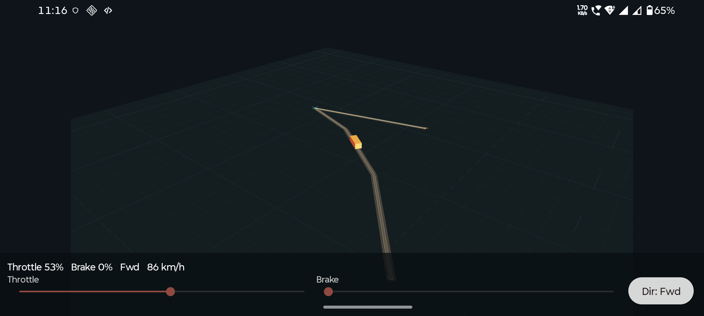

# Open Rails for Android (early skeleton)

An experimental, community-style Android port seed for
[Open Rails](https://openrails.org/) — the open-source train simulator.
This is **not** a working simulator yet. It is a runnable MonoGame/.NET 10
Android baseline plus CI that produces an installable debug APK.

## Resuming work

Read [`docs/SESSION-STATE.md`](docs/SESSION-STATE.md) first — it records current state,
device/adb details, packaging gotchas, and the next steps.

## Status

| Piece | State |
| --- | --- |
| MonoGame + .NET 10 Android app | **verified on device**: launches, renders at ~60 fps (Motorola Edge 50 Neo, Mali-G615, API 36) |
| GitHub Actions debug APK build | working |
| Content parsers: `.trk`, `.tdb`, `.eng`, `.wag`, `.con` | implemented, 31 unit tests |
| Text `.s` shapes + DDS/DXT textures | implemented; local real-add-on parser check |
| On-device sample-content screen | parses bundled route/TDB/consist from assets |
| Add-on folder import through SAF | implemented; needs CI/device verification |
| 3D track rendering from `.tdb` | **verified on device**: ground/ballast/rails/markers |
| Touch/cab controls | **verified on device**: throttle/brake, direction, moving train |

## Tests

The portable content core (`core/OpenRails.Core`) is plain .NET 10 with no
Android or MonoGame dependencies, so it runs anywhere:

```bash
dotnet run --project tests/OpenRails.Core.Tests/OpenRails.Core.Tests.csproj -c Release
```

CI runs this in the `test` job on every push, independently of the APK job.
The same tests parse `samples/` — a synthetic route (`.trk` + `.tdb`) and
consist — so the data that ships in the APK is validated too.

## Importing MSTS/Open Rails stock

Tap **Import addon folder** on the content screen and grant read access to an
MSTS/Open Rails folder. The importer reads `.wag` files, resolves the referenced
text `.s` shape, maps `.ace` references to same-name `.dds` files, decodes the
textures, and draws the shape on the track.

Select the **parent add-on folder** when the shape references shared textures
such as `../common/.../foo.dds`; selecting only the stock folder falls back to a
checker texture for those files. Binary `.s`, native `.ace`, animations, and
full articulated hierarchy are not supported yet.

## Build in CI

Push to `main` (public repo) or run the **build-apk** workflow manually.
The APK is uploaded as the `openrails-android-debug-apk` artifact.

Public-repo standard GitHub-hosted runners are free and do not consume
your monthly minutes. "Unlimited tokens" is not a GitHub Actions concept —
Actions is billed in **minutes**, and it has a 6-hour per-job cap.

## Device verification



Verified over `adb` on Android 16 (API 36, `arm64-v8a`): the startup content
screen parses the bundled `.trk`/`.tdb`/`.con` (`docs/device-content-screen.png`),
and **Start 3D demo** renders the track from the `.tdb` vector-section positions
(`docs/device-track-scene.png`). The bottom strip drives a portable
`TrainControlState`; raising throttle moved the locomotive along the track and
updated the speed readout (`docs/device-cab-controls.png`). The older cube
screenshot is `docs/device-running.png`. The app installs, launches, and holds
~60 fps.

Two packaging traps worth knowing:

1. Debug builds default to **Fast Deployment**: assemblies are *not* packed
   into the APK, and a sideloaded APK aborts with
   `No assemblies found in .../.__override__/arm64-v8a`.
   Fixed via `EmbedAssembliesIntoApk=True` (must be capital `T` — the targets
   compare case-sensitively) plus `AndroidEnableFastDeployment=false`.
   CI now fails if the app assembly is not embedded.
2. Each CI run generates a fresh debug keystore, so installing over an older
   build fails with `INSTALL_FAILED_UPDATE_INCOMPATIBLE`. Uninstall first:

```bash
adb uninstall org.openrails.android
adb install openrails-latest.apk
```

Quick device check:

```bash
adb install -r openrails-latest.apk
adb shell am start -n org.openrails.android/crc64c40e553b9fef0da3.MainActivity
adb exec-out screencap -p > screen.png
```

## If the app crashes

The debug build now logs every startup step and shows failures on screen.

- On-device log: `/sdcard/Android/data/org.openrails.android/files/startup.log`
- If startup throws, the exception and log are shown with **Copy log** and
  **Save to Downloads** (`/sdcard/Download/openrails-startup.log`).
- Wireless-debugging pairing only stays open while its dialog is on screen, so
  use the on-screen log/clipboard if you cannot keep it open.
- `adb logcat` (from Termux: `pkg install android-tools`, then Developer
  options → Wireless debugging → `adb pair` / `adb connect`):

```bash
adb logcat -d AndroidRuntime:E OpenRailsAndroid:V mono-rt:E DEBUG:E *:S
```

Recent yes/no checks already done: APK is a valid zip, both ABIs present
(`arm64-v8a`, `x86_64`), all packaged `.so` files are 16 KB-page aligned,
launcher activity resolves, target SDK 36.

## Build locally

Requires .NET 10 SDK, JDK 17, and Android SDK (API 36):

```bash
dotnet workload install android
dotnet build -c Debug -p:AndroidPackageFormat=apk
# -> bin/Debug/net10.0-android36.0/org.openrails.android-Signed.apk
```

## Roadmap to a real port

1. **Content layer** — route (`*.trk`, `*.tdb`), consist, `.eng` / `.wag`, text
   `.s` and DDS/DXT are in place; binary `.s`, native `.ace`, animations, and
   shared-texture routing are still to do.
2. **Renderer** — replace `BasicEffect` with a real 3D pipeline (instanced
   terrain, track, rolling stock). DirectX 9 code does not port; rewrite
   against OpenGL ES 3 / Vulkan.
3. **Simulation core** — reuse Open Rails' GPLv3 physics/route logic where
   it is portable, shimming Windows-only APIs.
4. **UI** — touch HUD, cab controls, in-game menus (WinForms editors must be
   replaced).
5. **Performance** — ARM profiling, LOD, asset streaming from storage.

## License

GPLv3 — see [LICENSE](LICENSE). Any distributed derivative of Open Rails
must remain GPLv3 with source available. Open Rails is © its contributors.
